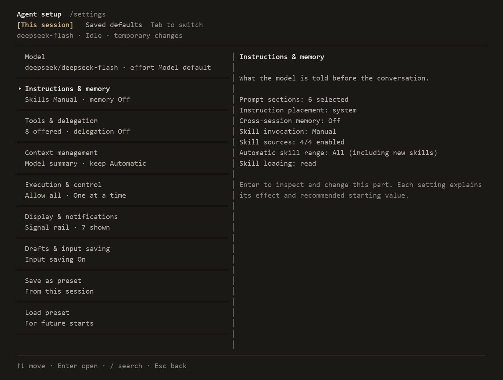

# Clarook

**See your context. Shape what comes next.**

Clarook is a terminal AI agent for inspecting API exchanges, editing context and configuring how your agent works.

- **See what the model sees.** Inspect request bodies, responses, returned reasoning and tool results.
- **Change what comes next.** Edit or exclude context inside the terminal while keeping the original history.
- **Build your agent.** Choose models, tools, skills and strategies, then save your setup as a preset.



Configure each component in `/settings`, for the current session or as a saved default.

[中文](README.zh-CN.md) · [Changelog](CHANGELOG.md)

## Getting started

Install Clarook:

```sh
npm install -g clarook@latest
```

Requires Node.js 22.19+.

Start it in your project directory:

```sh
clarook
```

On first launch, choose a provider, enter your API key, then select a model and its scope.

Type a task and press Enter to send it. Esc interrupts the turn; `/quit` exits.

Inside Clarook, use `/help` for commands and keyboard shortcuts, and `/settings` for configuration.

Menus use arrow keys to select, Enter to confirm and Esc to go back. Settings show their actions below the list; use ←→ to select one.

Run `clarook --help` for startup options.

To update to the latest release, close Clarook and run:

```sh
npm install -g clarook@latest
```

To run without a global installation, use `npx clarook@latest`.

A prebuilt package is also available in [GitHub Releases](https://github.com/hirovel/clarook/releases): `npm install -g https://github.com/hirovel/clarook/releases/latest/download/clarook.tgz`.

Clarook checks for updates after startup and shows a manual update command. Disable the check in saved defaults with `/settings checkUpdates`, or start with `--no-check-updates`. `/help update` shows update instructions.

## Using Clarook

### Inspect API exchanges

Ctrl+R opens requests in order. Select a request in the transcript with Shift+PgUp/PgDn, then press Ctrl+R to open its received content directly. Inspect sent messages, tool definitions, captured HTTP JSON, replies, returned reasoning and original tool output. In the sent and received views, use ↑↓ to select a block, Enter to expand it and PgUp/PgDn to page through its contents. Saved bodies, reconstructed views and missing records are labeled separately.

The event history saves the full tool declarations for the first ordinary request and whenever they change. Unchanged requests share the previous snapshot. Historical definitions remain inspectable after reload without optional recording attachments; older requests without sufficient evidence are labeled unavailable. These snapshots stay in the local history and do not add messages to the model input.

The received view includes replacement previews for `edit` and submitted content for `write`, alongside the tool's result state. Complete arguments remain available. These previews describe submitted text, not full-file snapshots.

### Edit context

Use Ctrl+R to inspect past requests and Ctrl+E to review the current projected context. The draft is excluded; sending may compact history or append context. Edit active system instructions, messages and tool results in the internal editor. Exclude messages, restore edited text, or rewind context to an earlier step. Original content and edit records remain available for comparison. Edits to summarized or cleared content and rewinds across a summary are refused because they would not produce the promised input. Retry selects an assistant reply from the active context.

Excluding history also marks the changed prefix for Anthropic's existing conservative thinking-replay policy: earlier blocks stay eligible, later historical blocks are omitted from the request. Recorded content remains inspectable. Chat reasoning keeps its configured replay behavior.

Summaries append paths referenced by read and write/edit calls. These lists identify calls, not confirmed file operations; inspect tool results to check their outcomes.

Each action states whether it changes the next input, sends a request immediately or creates a session file. After sending, inspect the captured request in Ctrl+R to check what was actually sent. Intervening log records appear in folded rows; select one and press Enter to inspect them.

Context estimates include the current tool definitions when no valid API measurement is available. A valid measurement already includes tools and is extended by newly added messages. Model changes, recorded tool changes and new images invalidate that baseline. Local estimates leave image tokens, private replay data and provider framing unmeasured; historical API usage remains available for comparison.

Interrupted replies keep their reported usage for inspection, but do not provide a complete context baseline. Forked children start their own measurement scope. Custom assembly requests estimate their actual message text; their measurements do not carry over to the standard projection. Automatic compaction still checks the standard projection before custom assembly.

`pnpm checkup <session.jsonl>` reports the observed gap between each stored prediction and the same request's reported input, including a summary of absolute and relative gaps. Its drift check measures stability, not accuracy; missing or interrupted input measurements are excluded from the gap summary.

### Configure your setup

`/settings` separates the current session from saved defaults. Select tools and automatic skills, configure skill directories, model effort and context strategies. Preview status-bar layouts and toggle individual components. Save and load named presets.

Keep tool definitions stable within a conversation when possible. Put task-specific preferences in messages; edit tool descriptions when you want to change their general guidance. Definition changes may reduce prompt cache reuse. MCP refreshes preserve the relative order of existing tools while applying updated definitions and executors.

Optional cost estimates cover the main session only, excluding child sessions. They use reported tokens and configured or catalog rates and are not a bill.

Skills are manual by default: `/name your request`. Automatic selection is optional. Skills follow the session's tool approval rules; skill metadata does not grant permissions. MCP tools and JavaScript/TypeScript extensions add capabilities or replace strategies.

MCP tool refreshes use a complete paginated list. Repeated cursors or more than 100 pages reject the refresh and keep the previous catalog. Closing a stdio connection also cleans up its local pipes and remaining POSIX process group when the direct server has already exited.

Context management includes Pi, Codex, ZCode and OpenCode reference compositions. New setups default to the Pi reference. Choose a composition, then adjust its trigger, recent-history budget, summary template, output limit and application rule. Details show the actual prompt, output format and differences from the source implementation. Use a `.md` file for your own summary prompt. These are text-based adaptations sharing Clarook's compaction loop; existing explicit settings take precedence.

For earlier compaction, set `compactionRatio` in `/settings`: `0` disables it; `0.8` is a starting point when enabled. Context length can affect information use, so earlier summaries may improve focus, but can lose detail and add requests. The context reserve may trigger sooner. `/compact` gives you manual control.

### Work and resume

Built-in tools read, write and edit files, run commands, search file contents and paths, and fetch pages. The agent continues through tool calls until the model finishes. In fullscreen mode, PgUp/PgDn pages through the transcript; Shift+PgUp/PgDn selects a request, and Enter folds or expands it when the input is empty. Esc closes a view or returns to live output before interrupting a running turn. `/session` creates, resumes and forks sessions. Type in the resume list to search all saved sessions by their latest user message, model or path. History, API bodies and original tool output are stored locally.

Use `@path` to attach a UTF-8 text file, or `@"path with spaces.txt"` for a path containing spaces. Type `@` to choose a file path; completion reads names only, and contents are attached when you submit. Multiple references, such as `Compare @a.txt @b.txt`, attach both files. Files over 50 KiB, binary files and invalid UTF-8 are skipped with a notice. Ctrl+V pastes an image; Alt+I lists attached images and lets you remove one.

Attachments come from your original input, independently of prompt-template substitution. For an installed `/review` template, `/review @a.txt @b.txt` attaches both files even if the template only uses `$1`. Templates and skills generate message text: their own `@path`, a constructed `@$1`, or a leading `!` stays text and does not automatically attach files or run a user shell command. Later model tool calls follow the session's approval rules.

A text-only response that reaches its output or context limit is kept as incomplete and stops without automatic continuation. Tool calls in a truncated response are not executed.

The `task` tool delegates work to a child context. Follow up with `resume: "sub-N"`: the child keeps its original type, selected provider/model, actual tool names, per-run step limit and remaining delegation depth, including after restarting Clarook. Raising the current depth does not expand its delegation rights; reducing it below the original requirement rejects the follow-up. Missing original resources or an explicit type change also reject it before model execution. Older child logs without an execution identity remain readable but cannot be resumed. Approval follows the parent's current rules; model aliases and tool implementations are not version-pinned.

Open these entries in `/settings`, switch to **Saved defaults**, and restart to use the new values. They also work in named presets and command-line flags:

| Setting under `defaults` | Default | Meaning |
| --- | --- | --- |
| `maxSteps` | unset / `null` | Main model steps per turn; no limit by default. `--max-steps N\|none` |
| `subagents.maxSteps` | `null` / `inherit` | Steps per child run. A type's limit wins, then this setting, then the parent's limit. `--subagent-max-steps N\|inherit` |
| `subagents.depth` | `1` | Child generations from main. `1`: children cannot delegate; `2`: grandchildren allowed. `--subagent-depth N` |

One model response and its tool batch count as one step, even when the batch contains several calls. Compaction requests and transport retries are outside this count. A low cap can stop unfinished work; it does not tune reasoning effort, output tokens or concurrency. These numeric settings accept positive integers; `none` removes the main cap, while child `inherit` uses the parent cap, including no limit. Saved changes preserve the first constraints of existing children. Move old top-level `subagents.maxSteps` and `subagents.depth` into `defaults.subagents`; old locations now fail at startup.

### Run your own commands

Type `!git status` and press Enter to run it and include the command and result in the next model context. Use `!!git status` to display and save both without adding them to context. `/shell` prepares the same input. Neither scope sends an API request.

The footer shows **Shell** and the selected context scope. Shift+Tab switches scope; idle Esc keeps the text and returns to chat. Typed and pasted prefixes work alike, including fullwidth `！` and `！！`.

Commands run while idle, from the project directory, with a 120-second timeout. Each command starts fresh; `cd` applies only to that command. Busy commands stay in the input. Images stay attached for chat, and `@path` is passed literally to the shell. Interactive programs requiring terminal input are not supported. Long output is saved in full with a readable path and a bounded preview.

Esc or a timeout requests cancellation, then ends local waiting without waiting for inherited output pipes. Captured output is kept; later output is no longer collected. The result is marked unknown because descendant termination and external effects are unverified. Windows uses `taskkill`. Normally completed commands still collect output until the streams close.

Providers support OpenAI Chat Completions, OpenAI Responses and Anthropic Messages. See the [relay configuration example](examples/config.relay.json) for compatible endpoints.

## Development

Clone the repository, install dependencies and run Clarook from source:

```sh
git clone https://github.com/hirovel/clarook.git
cd clarook
pnpm install
pnpm tui
```

Before submitting changes, run:

```sh
pnpm check
```

Compare configurations with real API calls from the source checkout:

```sh
pnpm evaluate validate evals/tool-descriptions.json
pnpm evaluate run evals/tool-descriptions.json .preview/evaluations/run-01
```

The experiment file sets the model, baseline, candidates, tasks and repetitions. Results include independent artifact checks, session records, CSV and an HTML report. `pnpm evaluate report <result-directory>` rebuilds the report without API calls. Each run needs a new output directory. Results apply to the tested model and tasks; configurations are never adopted automatically.

## License

[MIT](LICENSE)

Adapted summary templates retain their [third-party notices](THIRD_PARTY_NOTICES.md).

Formerly Clari.
