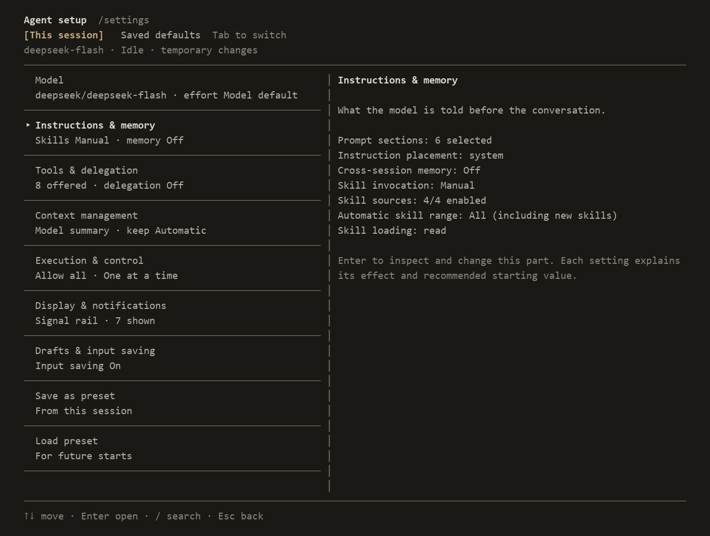

# Clarook

**看清上下文，决定下一步。**

Clarook 是一个终端 AI agent，让你查看 API 来回内容、编辑上下文，并配置 agent 的工作方式。

- **看清模型看到什么。** 查看请求正文、响应、返回的思考内容和工具结果。
- **决定下一次发送什么。** 在终端里编辑或排除上下文，保留原始历史。
- **组装自己的 agent。** 选择模型、工具、技能和策略，将组合保存为预设。



在 `/settings` 独立调整各个组件，应用于当前会话或保存为默认值。

[English](README.md) · [更新记录](CHANGELOG.md)

## 开始使用

安装 Clarook：

```sh
npm install -g clarook@latest
```

需要 Node.js 22.19+。

在项目目录启动：

```sh
clarook
```

首次启动时，选择供应商，输入 API key，再选择模型及其作用域。

输入任务，按 Enter 发送。Esc 中断当前轮，`/quit` 退出。

进入 Clarook 后，输入 `/help` 查看命令与快捷键，`/settings` 修改配置。

菜单用方向键选择、Enter 确认、Esc 返回。设置页的操作显示在列表下方，用 ←→ 选择。

运行 `clarook --help` 查看启动参数。

更新到最新发布版本，先退出 Clarook，再运行：

```sh
npm install -g clarook@latest
```

无需全局安装时，可用 `npx clarook@latest`。

[GitHub Releases](https://github.com/hirovel/clarook/releases) 也提供预构建包：`npm install -g https://github.com/hirovel/clarook/releases/latest/download/clarook.tgz`。

Clarook 启动后检查新版，显示手动更新命令。可在 `/settings checkUpdates` 的已保存默认值中关闭检查，或启动时加 `--no-check-updates`。`/help update` 查看更新说明。

## 使用 Clarook

### 查看 API 来回内容

Ctrl+R 按顺序列出每次请求。在主屏用 Shift+PgUp/PgDn 选中请求后，Ctrl+R 直接打开该请求的接收内容。查看发送的消息、工具定义、捕获的 HTTP JSON、回复、返回的思考内容和原始工具输出。在发送与接收视图中，↑↓ 选择内容块，Enter 逐块展开，PgUp/PgDn 翻页。保存的正文、重建视图和缺失记录分别标注。

事件历史在首次普通请求及工具定义变化时保存完整声明；未变化的请求沿用前一快照。重启后即使缺少可选录制附件，仍可检查当时的定义；旧请求缺少证据时明确标为不可用。快照保留在本地历史，不增加发给模型的消息。

接收视图提供 `edit` 替换预览和 `write` 提交正文，并标注工具结果状态。完整参数仍可查看；预览展示提交的文字，不是完整文件快照。

### 编辑上下文

Ctrl+R 查看历史请求，Ctrl+E 检查当前投影出的上下文。该视图不含草稿，发送时还可能压缩历史或追加上下文。在内部编辑器修改当前有效的系统指令、消息和工具结果，可以排除消息、恢复编辑前的原文，也可以将上下文回退到之前的步骤。原文与修改记录保留，可查看对照。已被摘要覆盖或清除的内容不能直接修改，也不能跨过摘要回退，程序会说明操作无法兑现的原因。重试只选择当前有效上下文中的助手回复。

排除历史也会把前缀变化传给 Anthropic 的既有保守回传策略：边界前的思考块保持可回传，后续历史思考块不再进入请求。日志原文仍可检查。Chat 可读思考沿用所配置的回传规则。

已知工具定义变化时，发送前省略变更前的 Anthropic 签名思考。清理后的输入产生的新块，在定义稳定且通过原有模型与上下文编辑检查时可以回传；切回旧定义也不恢复已省略块。原始记录保留。

旧请求缺少完整工具定义证据时，沿用现有模型与上下文编辑检查，保留原始签名块。缺证据本身不判为失效。当前声明不能证明历史定义，回传资格不依赖可选录制附件；客户端不保证服务端接受。

摘要附上 read 和 write/edit 调用涉及的路径。清单表示调用引用，执行结果需查看工具记录，不据此断言文件操作已完成。

压缩对照展示整次压缩开始前的生效上下文，计入编辑、排除、之前的摘要和已清除结果。Ctrl+E 使用同一份内容。复合策略可能在调用摘要前再次改变输入，该调用的正文需单独查看摘要请求。原始记录仍在 Events 查看；正文中的终端控制字符显示为可见转义。在 `replay --compaction N --json` 中，`covered` 和 `cleared` 保存生效消息，对应的 `*Indices` 指明来源事件。

每项操作说明是影响下一次输入、立即发送请求，还是创建会话文件。发送后，在 Ctrl+R 查看捕获的请求，核对实际发出的内容。消息之间的其他运行记录折叠为日志行，选中后按 Enter 查看记录。

没有有效 API 实测时，上下文粗估包含当前工具定义。有效实测已包含工具，只补算后续新增消息；模型切换、已记录的工具变化和新增图片会使旧基准失效。本地估算不包含图片 token、私有回传物和供应商协议封装，历史 API usage 仍保留供对照。

完整声明历史可证时，上下文估算和自动压缩会直接核对活动工具的名称、描述和参数；MCP 同名更新在保存新快照前也能识别。当前声明产生新的有效测量后，由它接替，不重复计算工具占用。

中断回复的 usage 保留供检查，但不作为完整上下文基准。fork 子任务从自己的测量范围开始。自定义组装请求估算它实际持有的消息正文，其测量不延用到标准投影；自动压缩仍在自定义组装前检查标准投影。

`pnpm checkup <session.jsonl>` 对照存储的预测与同一请求返回的输入用量，汇总绝对和相对差额。漂移判据检查稳定性，不证明准确；缺少输入测量或被中断的请求不进入差额汇总。

### 配置组合

`/settings` 分开当前会话与已保存默认值。勾选工具和自动技能范围，配置技能目录、模型思考强度和上下文策略。状态栏提供布局预览与组件开关，组合可保存为命名预设，随时加载。

会话中尽量保持工具定义稳定。单次任务的偏好写进消息；需要改变工具的一般使用建议时，再编辑描述。定义变化可能减少提示词缓存复用。MCP 刷新会保留已有工具的相对顺序，同时应用新的定义和执行器。

可选费用估算只统计主会话，不含子任务。金额依据返回的 token 用量和配置或目录价格计算，不是账单。

技能默认手动调用：`/名称 你的要求`，也可开启自动选择。工具统一遵循会话审批规则，技能元数据不授予权限。MCP 工具与 JavaScript/TypeScript 扩展可以添加能力或替换策略。

MCP 只用完整分页结果刷新工具表。重复 cursor 或超过 100 页会使刷新失败，旧工具表保留。关闭 stdio 连接时，即使直接服务进程已经退出，也会清理本地管道和剩余的 POSIX 进程组。

上下文管理提供 Pi、Codex、ZCode 和 OpenCode 参考组合，新组合默认采用 Pi 参考。选定后可分别调整触发时机、近期保留量、摘要模板、输出上限和应用条件。详情展示实际提示词、摘要格式及与来源实现的差异；自定义提示词可使用 `.md` 文件。这些文本方案共用 Clarook 的压缩流程，已保存的显式设置优先。

比例压缩可在 `/settings compactionRatio` 调整：`0` 关闭，开启建议从 `0.8` 开始。上下文长度会影响信息利用，提早摘要可能改善关注度，也可能丢失细节并增加请求。现有预留量可能更早触发。仍可用 `/compact` 手动控制。

### 执行任务与恢复会话

内置文件读取、写入、编辑、命令执行、内容搜索、路径搜索和网页读取工具。Agent 持续调用工具，直到模型结束回复。全屏模式中，PgUp/PgDn 翻阅正文；Shift+PgUp/PgDn 选择请求，输入为空时按 Enter 折叠或展开。Esc 先关闭视图或返回实时位置，再中断正在运行的当前轮。`/session` 新建、恢复和分叉会话。在恢复列表输入文字，按最后一条用户消息、模型或路径搜索全部已保存会话。历史、API 正文及原始工具输出保存在本地。

用 `@路径` 附入 UTF-8 文本，含空格的路径写成 `@"path with spaces.txt"`。输入 `@` 可以选择文件路径，补全只查文件名，提交时才读取正文。`比较 @a.txt 和 @b.txt` 会附入两份文件。超过 50 KiB、二进制或非法 UTF-8 文件会提示跳过。Ctrl+V 粘贴图片，Alt+I 查看附件列表并移除图片。

附件由原始输入决定，独立于提示词模板替换。如果已安装名为 `review` 的模板，`/review @a.txt @b.txt` 会附入两份文件，即使模板只用 `$1`。模板与技能只生成消息文字：正文里的 `@路径`、拼出的 `@$1` 或开头的 `!` 都保留为文字，不触发自动附件或用户 shell 执行。模型后续调用工具仍遵循会话审批规则。

`task` 工具把工作交给独立上下文的子任务。用 `resume: "sub-N"` 续聊时，保留首次类型、所选供应商/模型、实际工具名、每次运行的步数上限和剩余嵌套深度，重启后也一样。调高当前深度不会扩权，低于原深度则拒绝续聊。原资源缺失或显式改成另一类型时，也在向模型发送新任务前报错。旧子日志没有执行身份时仍可查看，但不能续聊。审批沿用父会话当前规则；模型别名背后的版本与工具实现本身不冻结。

在 `/settings` 打开以下设置，切到 **Saved defaults** 保存，下次启动生效。也可写入命名预设或命令行参数：

| `defaults` 下的设置 | 默认值 | 含义 |
| --- | --- | --- |
| `maxSteps` | 不设置 / `null` | 主任务每轮模型步数，默认无上限。`--max-steps N\|none` |
| `subagents.maxSteps` | `null` / `inherit` | 子任务每次运行步数。类型自身设置优先，其次本项，再继承父上限。`--subagent-max-steps N\|inherit` |
| `subagents.depth` | `1` | 从主任务向下的代数。`1` 表示子任务不能再派活，`2` 允许孙任务。`--subagent-depth N` |

一次模型回复及其后的一批工具调用算一步，一批有多个调用也只算一步。摘要请求和网络重试不计入这个计数。上限太小会让工作提前停止，不调整推理强度、单次输出 token 或并发。三项数字只接受正整数；主任务 `none` 取消上限，子任务 `inherit` 继承父上限，父不限时才不限。保存新默认值不覆盖已有子任务的首轮约束。旧顶层 `subagents.maxSteps` 和 `subagents.depth` 应移入 `defaults.subagents`，旧位置启动时报错。

纯文本回复达到输出或上下文上限时保留为不完整回答，停止自动继续。被截断回复中的工具调用不会执行。

### 执行自己的命令

输入 `!git status`，按 Enter 执行，命令和结果进入下一次模型上下文。`!!git status` 显示与保存两者，不加入上下文。`/shell` 准备同一个输入模式。两种范围都不会发送 API 请求。

底部显示 **Shell** 和选中的上下文范围。Shift+Tab 切换范围；空闲时 Esc 保留文字并返回聊天。键入与粘贴采用相同规则，也支持全角 `！` 和 `！！`。

命令在空闲时从项目目录运行，超时 120 秒。每条命令重新开始，`cd` 只影响该条命令。忙时命令保留在输入框。图片保留给聊天，`@路径` 原样传给 shell。不支持需要终端输入的交互程序。长输出完整保存，提供可读取路径和有限预览。

Esc 或超时会请求取消，随后结束本地等待，不再等后代持有的输出管道。已收到的输出保留，之后到达的输出不再收集。由于后代退出与外部副作用未获核实，结果标为 unknown。Windows 使用 `taskkill`。正常完成的命令仍收集到输出通道关闭。

支持 OpenAI Chat Completions、OpenAI Responses 和 Anthropic Messages。兼容端点可参考[中转配置示例](examples/config.relay.json)。

## 开发

克隆仓库，安装依赖，从源码运行 Clarook：

```sh
git clone https://github.com/hirovel/clarook.git
cd clarook
pnpm install
pnpm tui
```

提交修改前运行：

```sh
pnpm check
```

在源码目录用真实 API 比较配置：

```sh
pnpm evaluate validate evals/tool-descriptions.json
pnpm evaluate run evals/tool-descriptions.json .preview/evaluations/run-01
```

实验文件设置模型、基线、候选、任务与重复次数。结果包含独立产物验收、会话记录、CSV 和 HTML 报告。`pnpm evaluate report <结果目录>` 不调用 API，只重建报告。每轮使用新输出目录。结论限定于测试的模型和任务，不自动采用配置。

## 许可证

[MIT](LICENSE)

改编的摘要模板保留[第三方许可声明](THIRD_PARTY_NOTICES.md)。

曾用名 Clari。
